<p align="center">
  
</p>

<p align="center">
  
  
  
  
  
  
  
  
</p>

<p align="center">
  <a href="#inicio-rápido"><b>Inicio rápido</b></a> ·
  <a href="#así-se-ve">Así se ve</a> ·
  <a href="#qué-incluye">Qué incluye</a> ·
  <a href="#cómo-funciona">Cómo funciona</a> ·
  <a href="#despliegue">Despliegue</a> ·
  <a href="#extender">Extender</a> ·
  <a href="#documentación">Documentación</a>
</p>

---

**Starter Kit** es la base para construir aplicaciones internas (mesa de ayuda, portal de
clientes, backoffice, asistentes con IA) sin repetir lo de siempre. Trae resuelto el ingreso por
código al correo, roles y permisos aplicados en el servidor, un panel de administración completo,
IA con costos medidos y presupuestos, agentes versionados con chat flotante, conocimiento (RAG)
con citas y permisos por documento, y correo con plantillas y automatizaciones.

Es un monorepo pnpm con **Nuxt 4** (SSR con Nitro), **NestJS 12**, **PostgreSQL 18 + pgvector**,
un **worker** de trabajos durables (pg-boss) y **Docker**. Contratos Zod como fuente única de
OpenAPI y del cliente TypeScript. Todos los textos de la interfaz están en español de Chile.

> [!TIP]
> **¿Trabajas con un asistente de IA?** Pídele: *«Crea un proyecto llamado Mesa de Ayuda a partir
> de https://github.com/ecr17dev/startkit_nnp siguiendo su INSTALL.md; el propietario es
> tu@empresa.cl»*. [INSTALL.md](INSTALL.md) es una ruta sin preguntas, repetible y verificable;
> después [AGENTS.md](AGENTS.md), `PROJECT.md` y las [skills](.claude/skills/) le dan el contexto
> para seguir construyendo.

## Inicio rápido

Requisitos: **Node 24 LTS**, **Docker** con Compose v2 y **git** (pnpm se activa solo con
corepack).

```bash
git clone https://github.com/ecr17dev/startkit_nnp mesa-de-ayuda && cd mesa-de-ayuda
node scripts/quickstart.mjs --new "Mesa de Ayuda" --owner tu@empresa.cl --test-ai
pnpm dev
```

El quickstart instala dependencias, compila, genera `.env` con secretos únicos, levanta
PostgreSQL + pgvector y Mailpit en Docker, migra, asigna la persona propietaria y termina con
`QUICKSTART_RESULT=ok`. Es idempotente: si algo falla, corriges y lo repites.

| Abre | Para qué |
| --- | --- |
| http://localhost:3000 | Ingresa con el correo propietario |
| http://localhost:8025 | Mailpit: ahí llega el código de 6 dígitos en desarrollo |
| http://localhost:3000/api/docs | Swagger de la API (requiere el permiso `api.docs`) |

<details>
<summary><b>Variantes de instalación</b></summary>

| Quieres… | Agrega |
| --- | --- |
| Tu propio proyecto (nombre, contenedores y puertos propios, `PROJECT.md`) | `--new "Mesa de Ayuda"` |
| Chat funcionando sin claves (solo desarrollo) | `--test-ai` |
| Correo real con Resend | `RESEND_API_KEY=re_… node scripts/quickstart.mjs … --mail-from "App <no-reply@tudominio.cl>"` |
| Un proveedor de IA real | `OPENAI_API_KEY=… node scripts/quickstart.mjs … --ai openai --chat-model gpt-4.1-mini` |
| Tu PostgreSQL en vez del de Docker | `--db external --database-url postgres://…` |
| Empezar de cero la base local | `--reset-db` |

Sin `--new` el clon queda como el starter. Con `--new`, el starter queda como remoto `starter`
para traer mejoras. Detalle y solución de problemas en [INSTALL.md](INSTALL.md) y
[docs/installation.md](docs/installation.md).

</details>

## Así se ve

<table>
  <tr>
    <td width="50%" valign="top">
      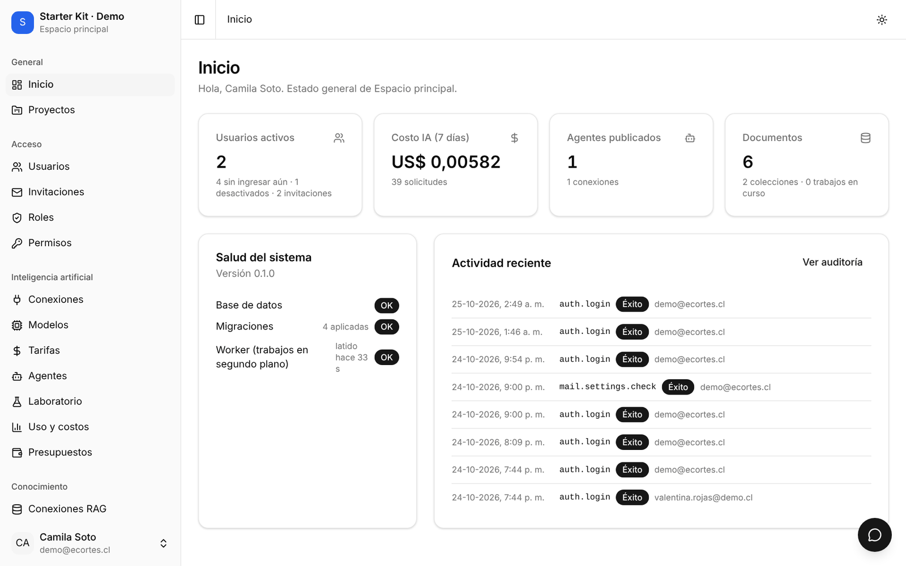
      <br><sub><b>Inicio</b> · usuarios, costo de IA de la semana, salud del sistema y actividad reciente.</sub>
    </td>
    <td width="50%" valign="top">
      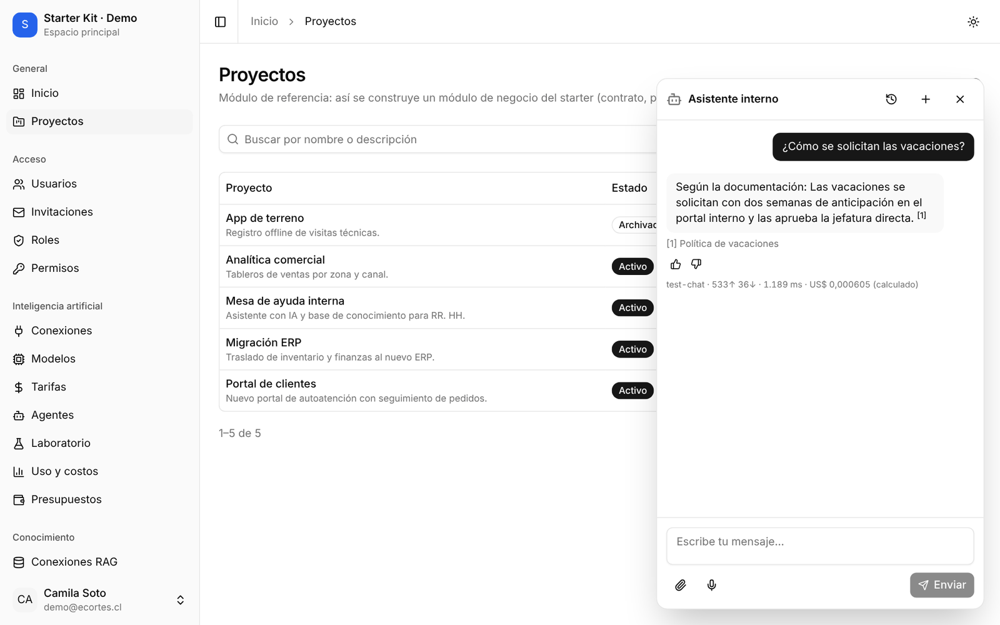
      <br><sub><b>Chat flotante</b> · responde con citas a tus documentos y muestra modelo, tokens y costo. En la captura, el proveedor de prueba determinista.</sub>
    </td>
  </tr>
  <tr>
    <td width="50%" valign="top">
      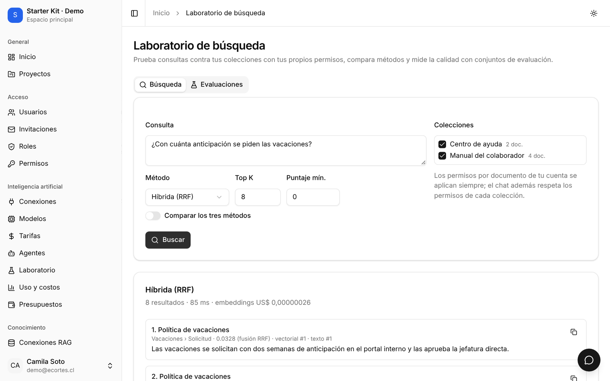
      <br><sub><b>Laboratorio de búsqueda</b> · búsqueda híbrida (RRF) con tus permisos, costo de embeddings y evaluaciones.</sub>
    </td>
    <td width="50%" valign="top">
      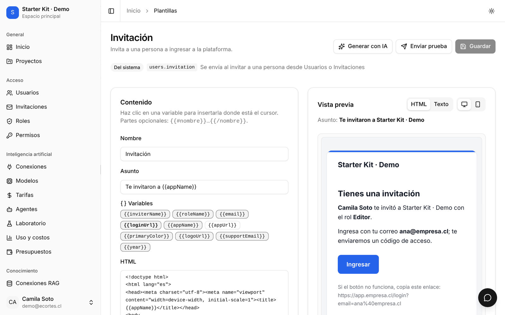
      <br><sub><b>Plantillas de correo</b> · variables con un clic, vista previa con tu marca, prueba de envío y generación con IA.</sub>
    </td>
  </tr>
  <tr>
    <td width="50%" valign="top">
      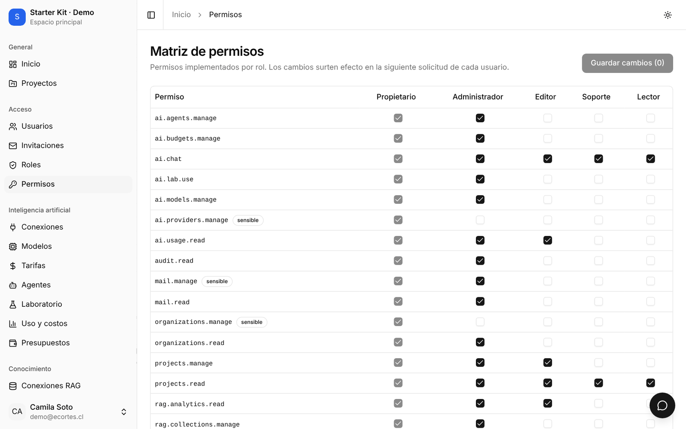
      <br><sub><b>Matriz de permisos</b> · cada permiso es una operación real del servidor; los sensibles se marcan.</sub>
    </td>
    <td width="50%" valign="top">
      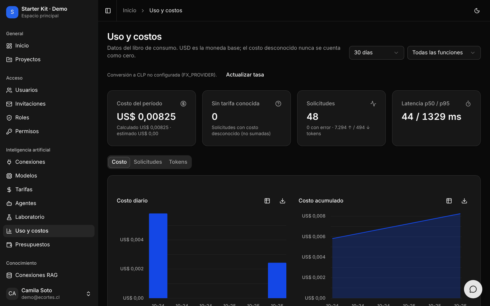
      <br><sub><b>Uso y costos</b> · libro de consumo, costo desconocido separado (nunca cero) y modo oscuro.</sub>
    </td>
  </tr>
</table>

<p align="center">
  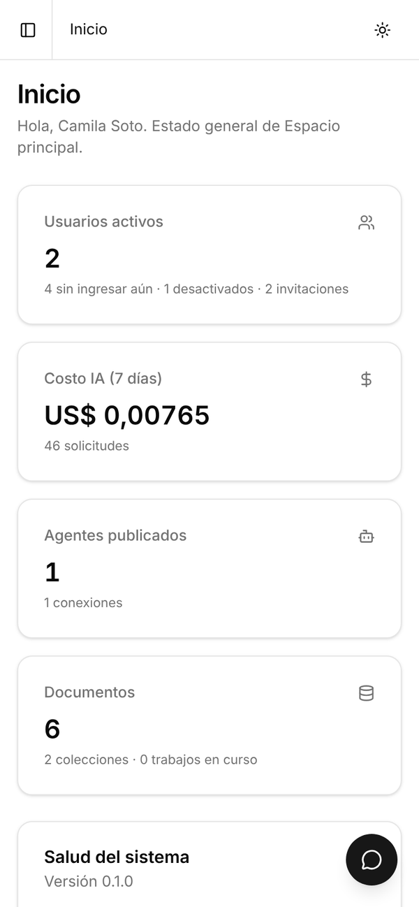
  &nbsp;
  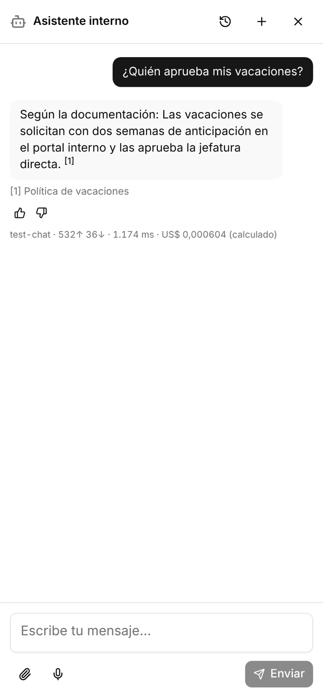
  &nbsp;
  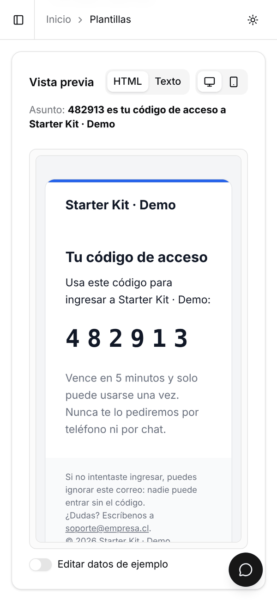
  <br><sub>Todo el panel funciona en el celular: inicio, chat a pantalla completa y vista previa de correos.</sub>
</p>

## Qué incluye

<p align="center">
  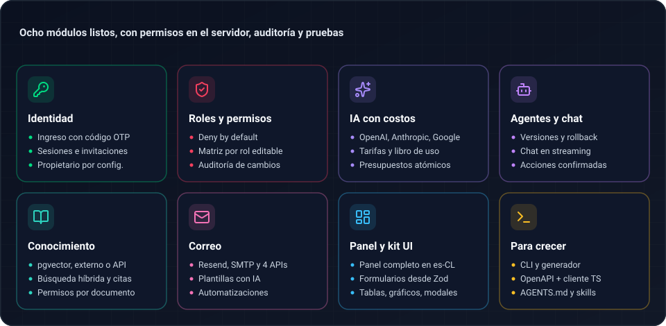
</p>

| Área | Contenido |
| --- | --- |
| **Identidad** | Ingreso con código OTP de 6 dígitos (5 minutos, 5 intentos, reenvío con espera), sesiones, invitaciones, persona propietaria definida por configuración (nunca el primer visitante), perfil y cuenta de demostración opcional fuera de producción |
| **Acceso** | Roles propietario, administrador, editor y lector, más roles propios; catálogo de permisos aplicado en el servidor (*deny by default*); organizaciones opcionales; auditoría inmutable |
| **Panel** | Usuarios, invitaciones, roles, matriz de permisos, configuración y marca, auditoría, diagnósticos, catálogo vivo de componentes y Swagger protegido |
| **IA** | Conexiones con claves cifradas (OpenAI, Anthropic, Google y compatibles), catálogo de modelos con verificación real, tarifas con historial, libro de uso (solicitudes e intentos; costo desconocido ≠ cero), presupuestos con reservas atómicas, conversión visual a CLP, recomendación de modelos y laboratorio |
| **Agentes y chat** | Agentes versionados (borrador, publicación y rollback), chat flotante con streaming y cancelación, adjuntos, dictado por micrófono y herramientas de administración que proponen y esperan confirmación |
| **Conocimiento** | Modo desactivado, interno (pgvector), PostgreSQL externo o API externa; colecciones con permisos por rol y documento; fuentes por archivo, URL, sitemap, texto o programadas; indexación durable con costo; búsqueda híbrida con citas, evaluaciones y analítica |
| **Correo** | Resend por defecto, SMTP propio o de cualquier proveedor, Postmark, SendGrid, Mailgun o Brevo, configurables y probados desde el panel; plantillas editables con vista previa y generación con IA; automatizaciones por evento o programación; registro de envíos |
| **Desarrollo** | Kit de interfaz (formularios desde Zod, asistentes, tablas o tarjetas, gráficos, modales), estándar de errores de punta a punta, generador de módulos desde **Proyectos**, CLI `pnpm starter`, OpenAPI y cliente TypeScript generado, E2E con Playwright |

## Cómo funciona

### Arquitectura

<p align="center">
  
</p>

- **Cuatro procesos:** `web` (Nuxt 4 con SSR), `api` (NestJS), `worker` (pg-boss) y `migrate`
  (aplica migraciones y datos base al desplegar). Un proxy de borde (Caddy en producción, Traefik
  en Dokploy) sirve todo desde un solo dominio: `/` a la web y `/api` a la API.
- **Una sola base:** PostgreSQL 18 guarda datos, sesiones, auditoría, la cola de trabajos y los
  vectores. No hace falta Redis, Kubernetes ni otra base vectorial.
- **Paquetes compartidos:** la lógica vive en `packages/*` (contratos, base de datos, acceso, IA,
  conocimiento, correo…) y la usan por igual la API, el worker y la CLI.
- **Contratos primero:** cada entrada y salida HTTP es un esquema Zod. De ahí salen la validación,
  el documento OpenAPI, la referencia Markdown y el cliente TypeScript que usa la web.

Más detalle en [docs/architecture.md](docs/architecture.md).

### Seguridad en cada solicitud

<p align="center">
  
</p>

La interfaz solo oculta lo que no corresponde; la seguridad está en el servidor. Cada endpoint
declara su permiso en `@Endpoint`, el servicio lo vuelve a comprobar con `assertCan`, toda
mutación administrativa queda en la auditoría (sin secretos) y la respuesta se valida contra su
contrato. Los errores salen del [catálogo](docs/errors.md) con un mensaje en español: un duplicado
es un 409 en el campo, nunca un 500.

### Chat con IA y costos

<p align="center">
  
</p>

- El cliente **no puede** enviar prompt de sistema, modelo ni colecciones: salen del agente
  publicado. Cada versión del agente queda guardada y se puede volver atrás.
- Antes de llamar al modelo se **reserva presupuesto** de forma atómica; el libro de uso registra
  cada intento con tokens, latencia y costo exacto. Un costo sin tarifa queda como desconocido.
- Una herramienta que cambia datos **no se ejecuta sola**: crea una propuesta en el servidor que
  la persona confirma, y se ejecuta con sus permisos y auditoría.

Guías: [proveedores](docs/ai-providers.md) · [modelos y tarifas](docs/models-and-pricing.md) ·
[costos](docs/costs.md) · [agentes y chat](docs/agents-and-chat.md) ·
[herramientas de administración](docs/admin-tools.md).

### Conocimiento (RAG)

<p align="center">
  
</p>

La ingesta corre como trabajo durable (progreso, reintentos y cancelación) y las descargas pasan
por `safeFetch` (protección SSRF, límites de tamaño y redirecciones). En la consulta se aplican
los permisos de colección y documento, se combina búsqueda vectorial y de texto (RRF) y el
contenido recuperado se trata como **datos, nunca como instrucciones**. El índice puede vivir en
pgvector, en un PostgreSQL externo o detrás de una [API externa](docs/rag-external.md).
Guías: [RAG](docs/rag.md) · [indexación](docs/indexing.md).

### Correo y automatizaciones

<p align="center">
  
</p>

El proveedor se elige y se prueba en **Correo → Proveedor** (la clave queda cifrada) o con
variables `MAIL_*`. Los códigos de acceso, invitaciones y alertas usan plantillas editables con
variables `{{así}}`. Las automatizaciones envían una plantilla cuando ocurre una acción auditada
(primer ingreso, proyecto creado…) o según un horario, sin duplicados y con reintentos. Guía:
[docs/mail.md](docs/mail.md).

## Despliegue

| Dónde | Cómo |
| --- | --- |
| **Servidor con Docker** | `docker/compose.yaml` + `compose.production.yaml`: web, API, worker, migrate y Caddy con HTTPS automático. Base de datos propia o incluida |
| **Dokploy** | `docker/compose.dokploy.yaml`, autosuficiente: PostgreSQL + pgvector, Mailpit opcional y la app detrás del Traefik de Dokploy, que pone el HTTPS |
| **Local completo** | Perfil de desarrollo con todo en contenedores en http://localhost:8080 |

Las imágenes se fijan por versión (nunca `latest`), el proveedor de IA de prueba y el correo `log`
se rechazan en producción, y `/admin/diagnostics` revisa base, migraciones, worker y correo tras
cada despliegue. Lista de control y comandos en [docs/docker.md](docs/docker.md).

## Extender

**Un módulo de negocio en un comando.** El generador copia el módulo de referencia **Proyectos**
(contrato, tabla, módulo Nest, vista, permisos, menú y prueba E2E) con tus nombres:

```bash
pnpm starter generate module clientes --entity Customer --label "Clientes" --singular "Cliente"
pnpm build:ts && pnpm db:generate && pnpm db:migrate
pnpm api:docs:generate && pnpm api:client:generate
```

Luego ajustas los campos en el contrato y la vista. El recorrido completo (endpoints a mano,
permisos, páginas, herramientas del chat y trabajos del worker) está en
[docs/extending.md](docs/extending.md), y las vistas se arman con el
[kit de interfaz](docs/frontend-components.md).

**Para agentes de código.** El repositorio está preparado para trabajar con IA:

| Archivo | Qué le da al agente |
| --- | --- |
| [AGENTS.md](AGENTS.md) (y `CLAUDE.md` / `GEMINI.md`) | Mapa del código, comandos, las 12 reglas no negociables y la definición de terminado |
| `PROJECT.md` | Contexto de tu proyecto (se crea con `--new`) |
| [.claude/skills/](.claude/skills/) | Pasos para instalar, extender, construir vistas, configurar IA y administrar conocimiento |
| [llms.txt](llms.txt) | Índice de la documentación para modelos |

## Comandos

| Comando | Qué hace |
| --- | --- |
| `node scripts/quickstart.mjs --owner <correo> [--new "<Nombre>"]` | Instalación local completa en un comando (idempotente) |
| `pnpm dev` | Compilación en modo watch + API + worker + Nuxt |
| `pnpm infra:up` / `pnpm infra:down` | PostgreSQL y Mailpit en Docker |
| `pnpm build` / `pnpm build:ts` | Compilación completa / solo paquetes y apps Node |
| `pnpm db:generate` / `pnpm db:migrate` | Genera migraciones Drizzle / aplica migraciones, cola de trabajos y datos base |
| `pnpm lint` · `pnpm typecheck` | ESLint · TypeScript (incluida la web) |
| `pnpm test` · `pnpm test:integration` · `pnpm test:e2e` | Unitarias · integración con PostgreSQL real · Playwright |
| `pnpm api:docs:generate` · `pnpm api:client:generate` · `pnpm api:contract:check` | OpenAPI y referencia · cliente TypeScript · cambios incompatibles |
| `pnpm docs:check` | Enlaces, comandos, `llms.txt`, configuración de ejemplo y versiones |
| `pnpm starter <comando>` | CLI: `create`, `init`, `doctor`, `config validate`, `mail use`, `mail test`, `ai connect`, `ai sync`, `rag doctor`, `rag reindex`, `generate module`, `docs check`, `owner assign` |
| `pnpm verify` | Verificación integral reproducible (escribe `verify-report.md`) |

## Calidad

| Capa | Qué cubre |
| --- | --- |
| **Unitarias** (Vitest) | Lógica pura: contratos, dinero exacto, renderizado de plantillas, errores, utilidades de la interfaz |
| **Integración** (PostgreSQL + pgvector real) | Permisos, auditoría, IA con proveedor de prueba, presupuestos, RAG, correo y automatizaciones |
| **E2E** (Playwright sobre la pila Docker) | Ingreso con código, panel, permisos, chat, conocimiento, correo y celular; suite completa en Chromium y los casos `@critical` también en Firefox y WebKit |
| **Contratos** | OpenAPI al día y detección de cambios incompatibles en la API |
| **CI** (GitHub Actions) | Lint, tipos, unitarias, contratos, integración y E2E en Chromium en cada cambio; Firefox y WebKit cada semana y en cada *release* |

`pnpm verify` corre la verificación completa en tu máquina (instalación, compilación, lint, tipos,
pruebas, artefactos de la API, documentación, variantes de Compose, build de la web, migraciones e
integración) y deja el resumen en `verify-report.md`. Guía de pruebas en [docs/e2e.md](docs/e2e.md).

## Estructura

```
apps/
  api/        NestJS: auth, administración, IA, agentes y chat, conocimiento, correo, proyectos, OpenAPI
  worker/     pg-boss: correo, IA (laboratorio, sincronizaciones, purgas), ingesta e indexación
  web/        Nuxt 4 + Nitro SSR: panel, chat flotante, vistas de correo y conocimiento
packages/
  config/     variables de entorno validadas, starter.config, secretos cifrados (SecretBox)
  contracts/  esquemas Zod compartidos: fuente de OpenAPI y del cliente; catálogo de errores
  db/         esquema Drizzle, migraciones y traducción de errores de PostgreSQL
  auth/       actor, permisos, políticas, auditoría, invitaciones, propuestas
  ai/         proveedores, catálogo, tarifas, libro de uso, presupuestos, agentes, chat
  rag/        almacenes (pgvector, PostgreSQL externo, API), parsing, ingesta, recuperación
  mail/       transportes (Resend, SMTP, Postmark, SendGrid, Mailgun, Brevo) y plantillas
  messaging/  administración del correo: proveedor cifrado, plantillas con IA, automatizaciones
  jobs/ storage/ observability/ ui/ api-client/
tooling/
  create-starter/   CLI create-ecortes-app / pnpm starter
  generator/        generador de módulos
docker/  docs/  scripts/  tests/  .claude/skills/
```

## Seguridad

- Los secretos viven solo en variables de entorno o cifrados con `APP_ENCRYPTION_KEY`, que nunca
  se guarda en la base. `starter.config.json` no admite secretos ni cadenas de conexión.
- El primer visitante nunca se vuelve administrador: la persona propietaria se define con
  `OWNER_EMAIL` o con `pnpm starter owner assign` desde el servidor.
- Cada operación valida permisos en el servidor; la interfaz solo oculta lo que no corresponde.
- El cliente no puede inyectar prompt de sistema, modelo ni colecciones; el actor de las
  herramientas del chat se inyecta en el servidor y los cambios requieren una propuesta confirmada.
- Los documentos del conocimiento son datos no confiables; las descargas tienen protección SSRF,
  límites de tamaño y redirecciones controladas.
- El proveedor de IA de prueba, el correo `log` y la cuenta de demostración se rechazan en
  producción; los códigos OTP nunca se registran en logs de producción.

## Estado de verificación

Cada capacidad se marca como **verificada** (integración o E2E contra PostgreSQL real y la pila
completa), **simulada** (proveedor de IA determinista para probar sin claves de pago),
**configuración pendiente** (requiere credenciales del proveedor en tu instalación) o
**no soportada** (la conexión declara que no la ofrece y la interfaz lo indica). Los proveedores
de correo por API distintos de SMTP y Resend están probados contra el formato documentado de cada
API con respuestas simuladas: confírmalos con **Enviar prueba** en el panel.

## Documentación

| Tema | Guías |
| --- | --- |
| Instalar y operar | [instalación](docs/installation.md) · [arquitectura](docs/architecture.md) · [Docker y Dokploy](docs/docker.md) · [actualizaciones](docs/upgrades.md) · [dependencias](docs/dependency-updates.md) · [problemas frecuentes](docs/troubleshooting.md) |
| Identidad | [autenticación](docs/authentication.md) · [permisos](docs/permissions.md) · [correo](docs/mail.md) · [herramientas de administración](docs/admin-tools.md) |
| IA | [proveedores](docs/ai-providers.md) · [modelos y tarifas](docs/models-and-pricing.md) · [costos](docs/costs.md) · [agentes y chat](docs/agents-and-chat.md) · [audio y multimedia](docs/audio-and-media.md) |
| Conocimiento | [RAG](docs/rag.md) · [API externa de recuperación](docs/rag-external.md) · [indexación](docs/indexing.md) |
| Desarrollo | [extender](docs/extending.md) · [kit de interfaz](docs/frontend-components.md) · [errores](docs/errors.md) · [pruebas E2E](docs/e2e.md) · [referencia de la API](docs/api-reference.md) |
| Para agentes | [AGENTS.md](AGENTS.md) · [INSTALL.md](INSTALL.md) · [skills](.claude/skills/) · [llms.txt](llms.txt) |

---

<p align="center">
  <sub>Propietario: Esteban Cortés · Especificación v1.1 · Versión del starter en <a href="starter.manifest.json"><code>starter.manifest.json</code></a></sub>
</p>
