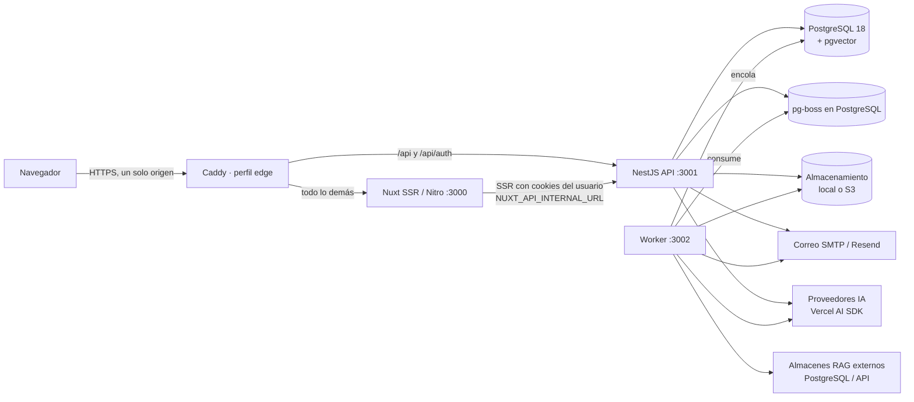

# Arquitectura

El starter es un monorepo **pnpm** con una aplicación web Nuxt 4 (SSR con Nitro), una API NestJS
que concentra la lógica de negocio y la autenticación, y un *worker* de trabajos durables. Todo
comparte el mismo PostgreSQL 18 (con pgvector cuando se usa conocimiento interno). No requiere
Redis, Kubernetes, una base vectorial adicional ni un framework de agentes.

## Componentes y flujo de una solicitud

- **Un solo origen**: en Docker, Caddy ([`docker/caddy/Caddyfile`](../docker/caddy/Caddyfile)) envía
  `/api/*` (incluido `/api/auth/*`) a la API y el resto a Nuxt. En desarrollo, Nitro reenvía `/api`
  a `http://localhost:3001` (`nitro.devProxy` en `apps/web/nuxt.config.ts`). Las cookies de sesión
  son `HttpOnly`, `SameSite=Lax` y `Secure` en producción.
- **SSR**: las páginas se renderizan en Nitro; durante el SSR el cliente generado llama a la API
  por `NUXT_API_INTERNAL_URL` reenviando las cookies de la persona. La API es siempre la fuente de
  verdad de permisos.
- **Streaming**: las respuestas del chat (AI SDK) se transmiten sin búfer (`flush_interval -1` en
  Caddy) y la cancelación del cliente se propaga hasta el proveedor.
- **Worker**: procesa colas pg-boss (sincronización de modelos y tarifas, laboratorio, alertas de
  presupuesto, ingesta/reindexación/eliminación RAG, purga de almacenamiento, mantenimiento). Las
  programaciones cron se ejecutan una sola vez aunque haya varias réplicas.

## Estructura del monorepo

| Ruta | Contenido |
| --- | --- |
| `apps/web` | Nuxt 4 (Vue 3, TypeScript estricto): páginas `/login`, `/verify`, `/onboarding`, `/admin/**`, chat flotante, middleware de ruta. |
| `apps/api` | NestJS 12 (Express): módulos `auth`, `admin`, `ai`, `agents`, `rag`, `projects`, `system`, `health`, `jobs`; scripts `migrate`, `generate-openapi`, `retrieval-test-server`. |
| `apps/worker` | Proceso de trabajos durables con endpoint de salud (`WORKER_HEALTH_PORT`, por defecto 3002). |
| `packages/contracts` | Esquemas Zod 4 compartidos (entradas, salidas, errores, catálogo de permisos, herramientas del chat). |
| `packages/api-client` | Cliente TypeScript generado desde `openapi.json` (`@hey-api/openapi-ts`). |
| `packages/config` | Contrato del entorno (`env.ts`), banderas de módulos, cifrado (`SecretBox`) y validador de `starter.config.json`. |
| `packages/db` | Esquema Drizzle, migraciones SQL versionadas, paginación y cliente. |
| `packages/auth` | Better Auth (OTP por correo), actor, políticas, roles, usuarios, invitaciones, auditoría, propuestas. |
| `packages/ai` | Conexiones a proveedores, catálogo de modelos, tarifas, libro de uso, presupuestos, agentes y chat. |
| `packages/rag` | Almacenes de conocimiento (pgvector interno/externo, API externa), ingesta, recuperación. |
| `packages/jobs`, `packages/storage`, `packages/mail`, `packages/observability` | Cola pg-boss, archivos (local/S3), correo (SMTP/Resend/log) y logs estructurados. |
| `packages/ui` | Capa Nuxt compartida: componentes shadcn-vue vendorizados, componentes comunes y gráficos. |
| `tooling/create-starter` | CLI `create-ecortes-app` / `pnpm starter`: `create`, `doctor`, `config validate`, `ai sync`, `rag doctor`, `rag reindex`, `generate module`, `docs check`, `owner assign`, `secrets reencrypt`. Usa los mismos paquetes de dominio que la API y el worker. |
| `tooling/generator` | Generador de módulos a partir del módulo de referencia Proyectos. |
| `tests` | Integración (Vitest + PostgreSQL real) y E2E (Playwright contra el stack Docker). |

## Contratos primero

1. Cada entrada y salida se define una vez con Zod en `@starter/contracts`.
2. Cada ruta Nest declara `@Endpoint({ operationId, summary, body/query/params, response, permission, feature, errors })`
   ([`apps/api/src/common/endpoint.ts`](../apps/api/src/common/endpoint.ts)). De esa declaración
   salen la validación en tiempo de ejecución (errores `VALIDATION_FAILED` → HTTP 422), los
   metadatos de autorización y la descripción OpenAPI.
3. `pnpm api:docs:generate` escribe `packages/api-client/openapi.json` y
   [`docs/api-reference.md`](api-reference.md); `pnpm api:client:generate` regenera el cliente.
4. Fuera de producción, `ResponseValidationInterceptor` valida cada respuesta JSON contra su
   esquema (en `NODE_ENV=test` la solicitud falla si no coincide), así el contrato no puede
   desviarse de la API real.
5. `pnpm api:contract:check` compara el OpenAPI actual con la línea base (`origin/main`) y marca
   cambios incompatibles (propiedades eliminadas, tipos cambiados, rutas quitadas).

## Autorización: denegar por defecto

- `AccessGuard` es global: una ruta **sin** `@Endpoint` se rechaza. Para cada solicitud resuelve
  la sesión de Better Auth, carga el **actor** desde la base (roles y permisos frescos, sin caché)
  y verifica `permission` (todas las requeridas) y `feature` (módulos `ai`, `rag`,
  `organizations`). Las denegaciones de operaciones de escritura quedan en la auditoría.
- Los servicios de dominio vuelven a comprobar con `assertCan(actor, ...)`: las mismas reglas se
  aplican desde REST, el chat (herramientas), el worker y la CLI.
- `CsrfMiddleware` rechaza solicitudes de escritura cuyo `Origin`/`Referer` no esté en
  `APP_URL` + `TRUSTED_ORIGINS` o que lleguen con `Sec-Fetch-Site: cross-site`.
- Cada solicitud recibe un `x-request-id` que se propaga a logs, uso de IA y trabajos.

### Actor

`loadActor` ([`packages/auth/src/actor.ts`](../packages/auth/src/actor.ts)) arma: usuario,
organización activa, organizaciones de las que es miembro, roles (de plataforma y de la
organización activa), permisos efectivos, permisos de plataforma, rango máximo, si es propietario y
el **canal** (`panel`, `api`, `chat`, `cli`, `system`). En el chat, el actor incluye el contexto
del agente (agente, conversación, llamada a herramienta) para la auditoría y **nunca** se toma de
los argumentos del modelo.

### Organizaciones (opcional)

Con `FEATURE_ORGANIZATIONS=false` todo vive en la organización por defecto ("Espacio principal").
Al activarlo, los datos de negocio quedan aislados por `organization_id`, los roles pueden ser de
plataforma u organización, y la persona cambia de organización desde el selector del panel
(`POST /api/me/organization`). Sin membresía en la organización activa solo aplican los permisos
de plataforma.

## Auditoría y observabilidad

- `recordAudit` registra quién (persona, canal, agente/conversación si vino del chat), qué
  acción, recurso, resultado (`success`, `denied`, `failed`, `cancelled`), antes/después con
  claves sensibles eliminadas, IP y `requestId`. Se consulta en `/admin/audit`.
- Los logs son JSON (pino) con `requestId`, `userId` y `organizationId`. Se redactan contraseñas,
  secretos, tokens, cookies, claves de API, `otp`/`code`, prompts y contenido de mensajes.
  **Los códigos OTP nunca se registran en producción**: el transporte de correo `log` (que
  muestra el mensaje en el log) está prohibido con `NODE_ENV=production` por el validador del
  entorno y por el propio mailer.
- `/api/health/live`, `/api/health/ready` y `/api/health/metrics` (Prometheus, permiso
  `system.diagnostics`); el worker expone `/health/live` y `/health/ready`. `/admin/diagnostics`
  resume versiones, colas y estado.

## Datos

- Migraciones SQL versionadas en `packages/db/migrations` (Drizzle Kit), aplicadas bajo un
  candado consultivo por `pnpm db:migrate` o el servicio `migrate` de Docker. Después se aplican
  los datos base idempotentes: organización por defecto, catálogo de permisos y roles de sistema,
  propietario inicial (`OWNER_EMAIL`) y asistente por defecto sin publicar.
- La aplicación puede usar un rol de base de datos sin privilegios de DDL (`starter_app`,
  creado por `docker/postgres/init/01-app-role.sh`); las migraciones usan
  `DATABASE_MIGRATION_URL`.
- Las credenciales de proveedores y de conexiones de conocimiento se cifran con
  `APP_ENCRYPTION_KEY` (AES-256-GCM, clave fuera de la base) y admiten rotación con
  `APP_ENCRYPTION_PREVIOUS_KEYS` + `pnpm starter secrets reencrypt`.
- El catálogo de permisos se sincroniza en cada migración: las claves nuevas reciben los permisos
  por defecto de los roles de sistema y las existentes conservan la configuración local.
- Montos de dinero con precisión decimal exacta (no flotantes); el costo desconocido nunca se
  registra como cero (ver [costs.md](costs.md)).

## Decisiones clave

| Decisión | Motivo |
| --- | --- |
| PostgreSQL para todo (datos, sesiones, cola, vectores) | Menos piezas que operar; pg-boss y pgvector cubren colas y búsqueda semántica. |
| Better Auth solo con OTP por correo | Sin contraseñas que filtrar; rutas no usadas deshabilitadas (`DISABLED_AUTH_PATHS`). |
| Zod como única fuente de contratos | Validación, OpenAPI y cliente salen del mismo esquema. |
| Permisos implementados = catálogo | No existen permisos "decorativos": cada clave la exige al menos una operación. |
| Propuestas para cambios sensibles del chat | El modelo no puede confirmar; solo la persona desde la interfaz. |
| AI SDK sin framework de agentes | Herramientas tipadas sobre los mismos servicios de dominio. |
| shadcn-vue vendorizado | Los componentes son código del proyecto; se actualizan con un script y revisión manual. |

Más detalle: [installation.md](installation.md), [authentication.md](authentication.md),
[permissions.md](permissions.md), [docker.md](docker.md), [extending.md](extending.md),
[ai-providers.md](ai-providers.md), [agents-and-chat.md](agents-and-chat.md), [rag.md](rag.md).
